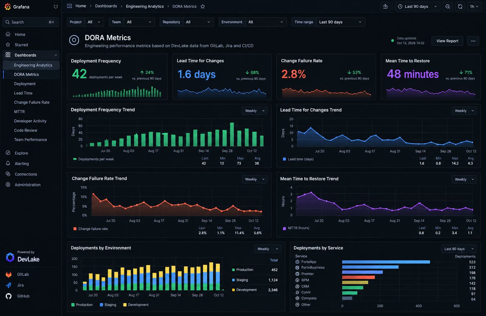
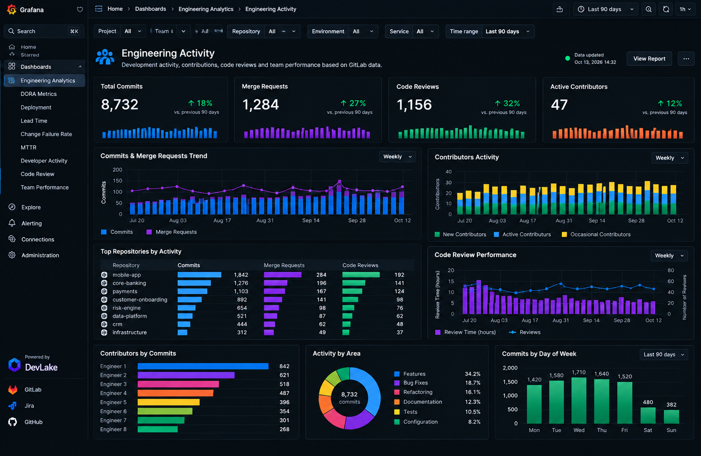

# Engineering Performance Analytics

### Apache DevLake | Grafana | DORA Metrics | GitLab | Jira

## Overview

Designed and implemented an engineering analytics solution using
Apache DevLake and Grafana to provide centralized visibility into
software delivery performance, engineering activity, and system reliability.

The solution consolidates engineering data from development tools
and transforms it into actionable dashboards for engineering leadership.

The primary objective was to move from manual reporting toward
continuous, data-driven engineering management.

> **Demo note:** The dashboard images below are illustrative
> visualizations using synthetic data. They represent the types
> of engineering analytics dashboards implemented in enterprise
> fintech environments. The displayed metrics are not actual
> company performance figures.

---

## 1. The Challenge

Managing multiple engineering teams across enterprise fintech
platforms requires continuous visibility into delivery performance.

Traditional reporting presented several challenges:

- Engineering metrics were distributed across different tools.
- Management reporting required manual data collection.
- Delivery bottlenecks were difficult to identify early.
- Release performance lacked a unified measurement framework.
- Engineering activity was not easily visible across teams.
- Technical decisions were often based on fragmented information.

The goal was to establish a centralized engineering
performance monitoring solution.

---

## 2. The Solution

Implemented an engineering analytics platform combining
Apache DevLake and Grafana.

### Architecture

The solution connects engineering data sources
to a centralized analytics and visualization layer.

**Data Sources:**
- GitLab
- Jira
- CI/CD pipelines

**Data Collection & Analytics:**
- Apache DevLake

**Visualization:**
- Grafana

**Management Layer:**
- Engineering Performance Dashboards
- DORA Metrics
- Engineering Activity Analytics

### Data Flow

```text
GitLab ──────┐
             │
Jira ────────┼──> Apache DevLake ──> Grafana
             │                           │
CI/CD ───────┘                           │
                                        ▼
                              Engineering Leadership
                               Performance Analytics
```

---

## 3. DORA Metrics Dashboard

Implemented automated engineering performance
monitoring based on the four key DORA metrics.

### Deployment Frequency

Tracks how frequently engineering teams
successfully deploy changes to production.

### Lead Time for Changes

Measures the time required for code changes
to move from development to production.

### Change Failure Rate

Tracks the percentage of deployments
resulting in production failures.

### Mean Time to Restore Service (MTTR)

Measures how quickly services recover
after production incidents.

### Dashboard Demonstration



*Illustrative Grafana dashboard using synthetic data.*

### Business Value

- Continuous visibility into delivery performance.
- Better identification of engineering bottlenecks.
- Improved understanding of release reliability.
- Faster identification of operational issues.
- Data-driven engineering improvement initiatives.

---

## 4. Engineering Activity Dashboard

Implemented engineering activity analytics
to monitor development workflows and
team-level engineering trends.

### Key Capabilities

**Code Contributions**
- Commit activity over time
- Repository-level contributions
- Engineering activity trends

**Merge Requests**
- Merge request activity
- Code review workflows
- Review turnaround time

**Engineering Collaboration**
- Cross-team development activity
- Repository contribution trends
- Code review performance

**Development Insights**
- Engineering workload indicators
- Changes across repositories
- Team activity distribution

### Dashboard Demonstration



*Illustrative engineering activity dashboard using synthetic data.*

### Important Principle

Engineering activity metrics are used
to understand delivery workflows and
identify bottlenecks.

Commit counts and code activity are
not treated as direct measures of
individual developer productivity.

---

## 5. AI-Assisted Engineering Intelligence

Extended engineering analytics capabilities
through AI-assisted analysis using AWS Kiro.

Integrated engineering knowledge sources
such as Jira, GitLab, and Confluence.

The approach enabled natural-language
analysis of engineering information.

### Use Cases

- Analyzing development activity
- Reviewing engineering contributions
- Understanding project progress
- Identifying potential workload imbalances
- Retrieving information from multiple systems
- Supporting engineering management decisions

This reduced repetitive manual investigation
and improved access to engineering information.

---

## 6. Engineering Leadership Impact

### Before

- Fragmented engineering information
- Manual management reporting
- Limited visibility into delivery trends
- Time-consuming engineering analysis
- Reactive identification of delivery issues

### After

- Centralized engineering dashboards
- Automated collection of engineering metrics
- Continuous DORA performance monitoring
- Improved engineering activity visibility
- Faster access to delivery information
- More consistent data-driven decisions

---

## 7. Technologies

| Technology | Purpose |
|---|---|
| Apache DevLake | Engineering data collection and analytics |
| Grafana | Dashboards and visualization |
| GitLab | Source control and development activity |
| Jira | Project and issue tracking |
| CI/CD | Deployment and delivery information |
| AWS Kiro | AI-assisted engineering analysis |

---

## 8. Engineering Philosophy

Engineering metrics should help teams improve,
not become tools for individual surveillance.

I focus on measuring outcomes rather than
simply tracking engineering activity.

The objective is to improve:

- Delivery predictability
- Engineering efficiency
- System reliability
- Developer experience
- Operational transparency
- Continuous improvement

---

## Related Projects

[AI-Assisted Software Development Lifecycle](../01-ai-assisted-sdlc/)

[AI-Powered Mobile E2E Testing](../02-ai-mobile-testing/)

[Back to Engineering Automation Portfolio](../)
