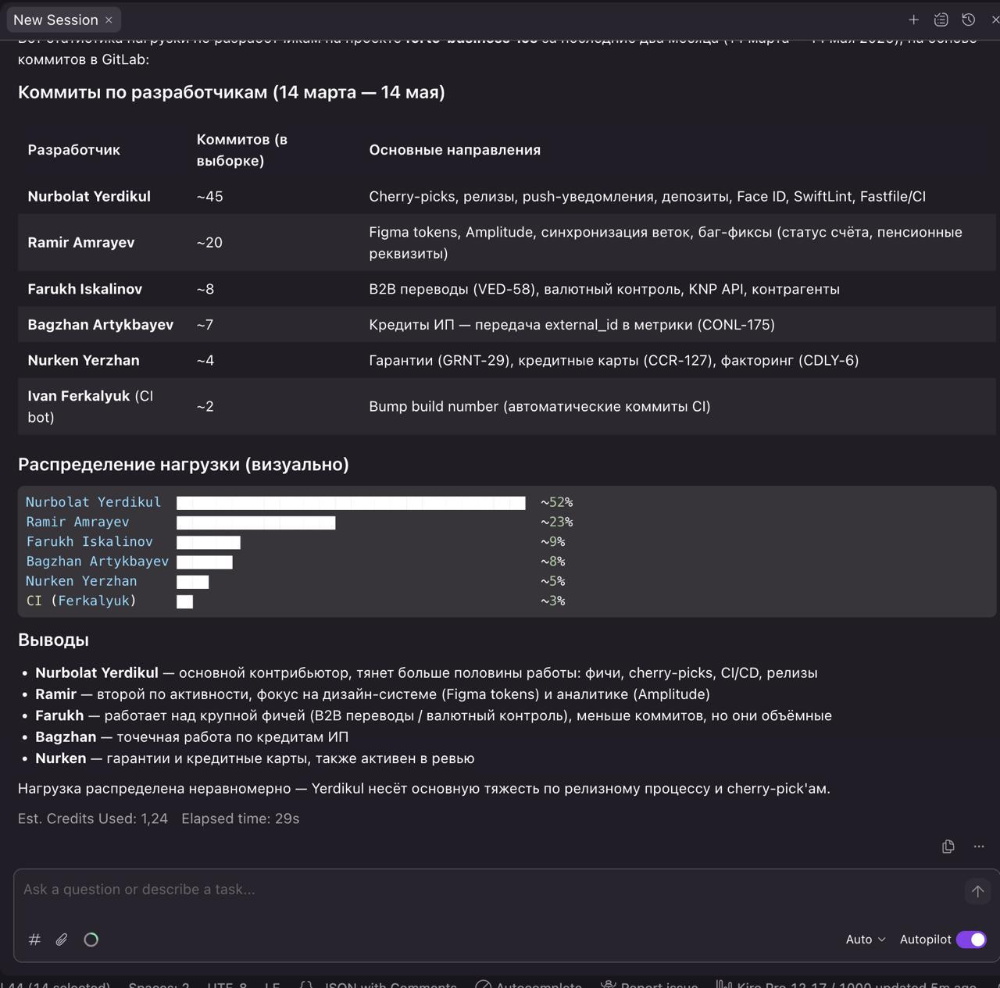

## AI-Powered Engineering Intelligence

Integrated AWS Kiro with Jira, GitLab,
and Confluence to enable AI-assisted
engineering analysis.

### AI-Generated Engineering Analysis

### Business Impact

- Faster access to engineering information.
- Automated analysis of development activity.
- Improved workload visibility.
- Reduced manual management reporting.
