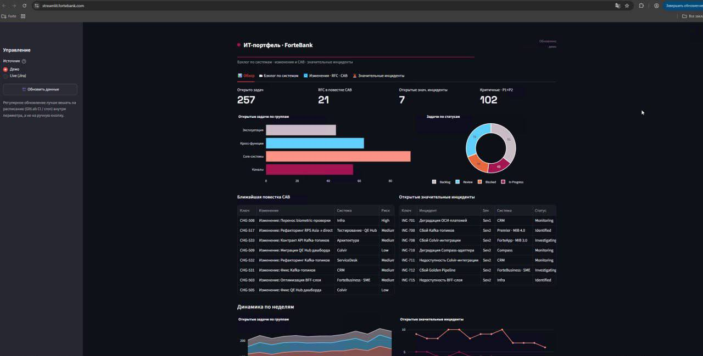
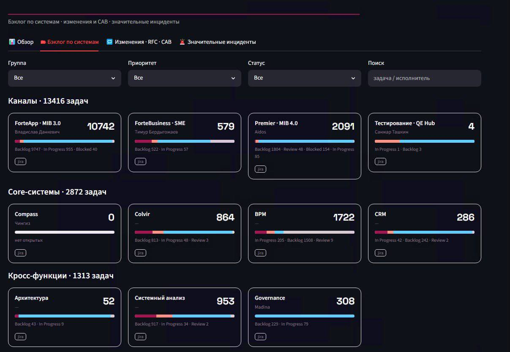

# Engineering Portfolio Intelligence

### Python | Streamlit | Jira | Delivery Governance

## Overview

Designed and implemented an internal engineering
portfolio management dashboard using Python and Streamlit.

The platform provides centralized visibility into
engineering delivery, project backlogs, release
governance, and operational incidents.

## The Challenge

Managing multiple engineering teams required
consolidating information from different systems.

Key challenges included:

- Fragmented project reporting
- Limited cross-team delivery visibility
- Manual backlog analysis
- Release readiness tracking
- Incident monitoring
- Engineering workload distribution

## The Solution

Built a centralized engineering management platform
using Python and Streamlit.

### Portfolio Management

- Project-level backlog visibility
- Task statuses and priorities
- Cross-team delivery tracking
- Workload distribution
- Weekly delivery trends

### Release Governance

- RFC tracking
- CAB agenda monitoring
- Change management visibility
- Release readiness overview

### Incident Management

- Significant incident tracking
- Severity classification
- Incident status monitoring
- Operational risk visibility

### Engineering Capacity

- Team workload analysis
- Cross-team activity visibility
- Identification of potential bottlenecks

## Business Impact

**Centralized management visibility**

Replaced fragmented reporting with a unified
engineering portfolio dashboard.

**Faster decision-making**

Enabled engineering leadership to identify
delivery risks and operational issues earlier.

**Improved governance**

Connected project delivery, release management,
and incident monitoring in a single interface.

**Reduced manual coordination**

Minimized repetitive information gathering
across multiple engineering teams.

## Technologies

- Python
- Streamlit
- Jira
- Data Visualization
- Engineering Analytics

## Demonstration

### Engineering Portfolio Overview

### Engineering Backlog Monitoring

*Illustrative screenshots based on the implemented
engineering portfolio management solution.*

## Related Projects

[Engineering Analytics](../03-engineering-analytics/)

[Back to Portfolio](../)
